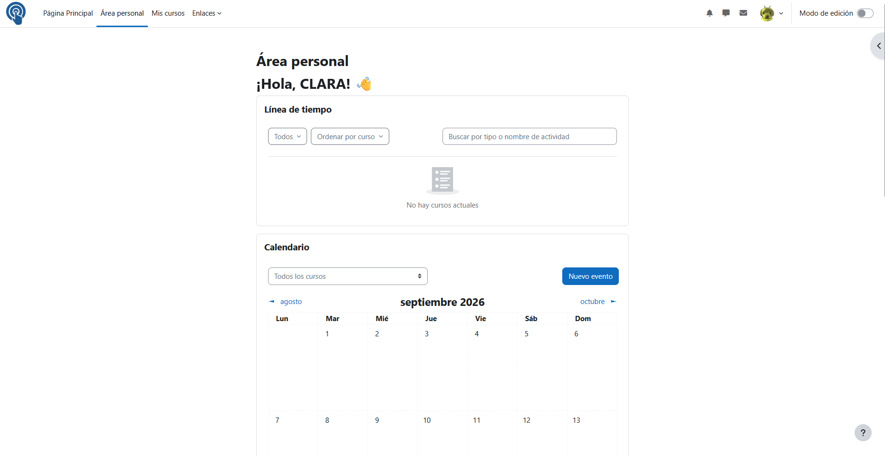

# Tutorial de cómo entrar en Aula Virtual
En este tutorial se va a enseñar la forma correcta de cómo entrar en la plataforma **AulaVirtual**

## Primer paso

Abrir el navegador de preferencia, ya sea *Chrome*, *Firefox* u *Opera*. 

## Segundo paso

Escribir la url [https://aulavirtual.murciaeduca.es](https://aulavirtual.murciaeduca.es)

## Tercer paso

Iniciar sesion introduciendo los credenciales correspondientes

## Cuarto paso

Una vez se han proporcionado las credenciales ya podremos acceder a nuestro perfil de Aula Virtual

