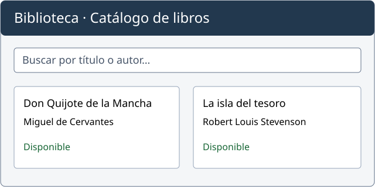

# CV: de HTML básico a HTML semántico

Abre esta carpeta en VS Code y utiliza Live Preview. También puedes abrir los HTML directamente para comparar su contenido.

## Versiones

- `cv.html`: punto de partida con encabezados, párrafos, listas y tablas, además de imágenes y enlaces. El texto del pie de imagen es un párrafo. No incorpora todavía regiones semánticas, etiquetas de texto específicas ni formulario.
- `cv-div.html`: versión intermedia organizada con contenedores genéricos `div`; incorpora etiquetas de contenido y formulario para compararla con la versión semántica.
- `cv-semantico.html`: el contenido de `cv-div.html` con `header`, `nav`, un `main`, cinco `section`, un `article`, un `aside` y `footer`.

Las tres versiones utilizan únicamente HTML, sin hojas de estilo ni JavaScript. El navegador muestra su presentación predeterminada: menú vertical y tablas sin bordes añadidos. Compara la estructura y el significado de las etiquetas; el aspecto puede ser muy parecido. Todas utilizan HTML actual. Los colores del avatar, logotipo y prototipo forman parte de los archivos SVG; no son estilos CSS aplicados al documento HTML. En la unidad de CSS podrás añadir presentación al mismo CV.

Los encabezados, párrafos, listas y tablas de `cv.html` ya aportan significado. Es una versión básica, no un documento carente de semántica. Las versiones posteriores permiten introducir progresivamente etiquetas nuevas.

## De cv.html a cv-semantico.html

Parte de `cv.html`. Guarda una copia como `mi-cv-semantico.html` y aplica los cambios siguientes. Usa `cv-semantico.html` para contrastar el resultado. `cv-div.html` es una comparación adicional de agrupaciones genéricas; no es un paso obligatorio.

### 1. Mantener lo que ya tiene significado

Conserva los encabezados `h1`, `h2` y `h3`, los párrafos `p`, las listas `ul` y `li`, las tablas, las imágenes y los enlaces. No hay que sustituirlos por etiquetas nuevas. Mantén también `head`, los metadatos y el idioma del documento.

El menú debe seguir llegando a los mismos identificadores. Si trasladamos `id="estudios"` del encabezado a la sección que lo contiene, lo quitamos del encabezado para no duplicarlo.

### 2. Identificar las partes de la página

| En cv.html | Cambio en la versión semántica | Motivo |
| --- | --- | --- |
| Logotipo, título principal y avatar al inicio | Agruparlos en `header`. | Presentan el CV. `header` no sustituye a `h1`. |
| Lista de enlaces a los apartados | Envolver la lista en `nav`. | Su función es permitir navegar por el CV. Se conservan `ul`, `li` y `a`. |
| Información personal, estudios, experiencia, proyectos, recursos y contacto | Reunirlos en un único `main`. | Constituyen el contenido principal de esta página. |
| Cada apartado principal | Agruparlo en `section` con su `h2`. | Trata un tema concreto del CV. |
| Logotipo final y copyright | Agruparlos en `footer`. | Cierran la página. |

Antes:

```html
<h2 id="estudios">Estudios</h2>
<table>
    <!-- Las filas de estudios ya existentes. -->
</table>
```

Después:

```html
<section id="estudios">
    <h2>Estudios</h2>
    <table>
        <!-- Se conservan las mismas filas. -->
    </table>
</section>
```

Estos fragmentos muestran solo el cambio de agrupación: conserva la tabla completa del archivo. Las etiquetas no colocan los bloques en posiciones concretas de la pantalla.

### 3. Distinguir section, article y aside

Dentro de la sección «Proyectos destacados», agrupa el catálogo en un `article`: su título, fecha, descripción, imagen y resultado forman una unidad que se entiende por separado. Mantén el `h3` porque depende del apartado de proyectos, encabezado por un `h2`.

El artículo tiene su propio `header` para el título y su `footer` para la nota del proyecto. Pertenecen al artículo, no al CV completo. No es obligatorio añadir cabecera y pie a todas las secciones.

Agrupa «Tecnologías relacionadas» en `aside`, conservando su identificador y su lista. Aquí son enlaces de consulta complementarios. Si fueran las competencias que dominas y quieres presentar a una empresa, normalmente formarían una `section` principal.

No añadas un `main` dentro de cada apartado. Una sección puede contener artículos y un artículo extenso puede contener secciones; no es necesario forzar ambas relaciones en todos los documentos.

### 4. Dar significado a la imagen y su explicación

En el archivo básico, la ilustración y su explicación son una imagen seguida de un párrafo. En el artículo, agrúpalas así:

```html
<figure>
    
    <figcaption>Figura 1. Prototipo ilustrativo del catálogo de la biblioteca escolar.</figcaption>
</figure>
```

`figure` reúne una unidad de contenido y `figcaption` identifica su pie visible. `alt` sigue ofreciendo la alternativa textual de la imagen. El logotipo y el avatar permanecen como imágenes sencillas: no todas las imágenes necesitan `figure`. El título de las tablas continúa siendo `caption`.

### 5. Añadir significado dentro del texto

Conserva las palabras y marca únicamente los fragmentos que correspondan:

| Antes | Después | Qué aporta |
| --- | --- | --- |
| `2025` | `<time datetime="2025">2025</time>` | Identifica el año; `datetime` contiene el valor interpretable por programas. |
| `HTML` | `<abbr title="HyperText Markup Language">HTML</abbr>` | Identifica una abreviatura y permite indicar su desarrollo. |
| `organizar la información y facilitar la consulta` | `<strong>organizar la información y facilitar la consulta</strong>` | Señala una idea importante del trabajo realizado. |
| `facilitar la búsqueda de una lectura` | `<em>facilitar la búsqueda de una lectura</em>` | Introduce énfasis en esa expresión. |
| `Don Quijote de la Mancha` | `<cite>Don Quijote de la Mancha</cite>` | Identifica el título de una obra, no el nombre de su autor. |
| `Proyecto realizado en 2025.` | `<small>Proyecto realizado en 2025.</small>` | Marca una anotación secundaria del proyecto. |

Aplica también `small` al copyright dentro del párrafo del pie general. No significa que el texto carezca de importancia ni sirve para reducir el tamaño de cualquier párrafo.

La lista de responsabilidad, destinatarios y resultado sigue siendo `ul` con `li`: esos datos no tienen un orden obligatorio. No necesitas `dl`, `dt` ni `dd` para esta práctica.

### 6. Identificar el contacto y distinguir la ampliación del formulario

Sustituye el párrafo de contacto por `address`, conservando el enlace:

```html
<address>
    Contacto de Alex García:
    <a href="mailto:alex.garcia@example.org">alex.garcia@example.org</a>.
</address>
```

Expresa el contacto del titular del CV. No se usa para cualquier dirección postal que aparezca en el documento.

El formulario es una ampliación que aparece en las versiones posteriores, pero no en `cv.html`. Puedes dejarlo para cuando estudies formularios: no hace falta para completar la transformación semántica del contenido inicial. En él, `form` reúne los controles, `fieldset` los agrupa, `legend` describe el grupo, `label` identifica el campo, `input` recoge el correo y `button` solicita el envío. `for` e `id` deben coincidir; `name` identifica el dato enviado.

Si copias el formulario a `mi-cv-semantico.html`, adapta su `action` a ese nombre. Conserva la información sobre su funcionamiento del apartado «Imagen y formulario» de este README.

### 7. Comprobar el resultado

- Conserva los textos, las tablas y las listas del CV inicial; las nuevas etiquetas expresan mejor su función.
- Comprueba que hay un solo `main`, identificadores únicos y una jerarquía `h1` → `h2` → `h3` coherente.
- Prueba los enlaces del menú y las imágenes. Las rutas siguen siendo relativas a la carpeta del HTML.
- Recorre los enlaces y, si incorporaste el formulario, sus controles con Tab.
- Valida el documento completo con [Nu HTML Checker](https://validator.w3.org/nu/#textarea).
- Compara con `cv-semantico.html` y explica cada diferencia. Un cambio visual no demuestra por sí solo una mejora semántica; tampoco necesitas añadir roles que repitan la función de los elementos nativos.

## Qué representa cada elemento

- **`section` — Estudios, Experiencia, Proyectos…:** agrupa un apartado temático del currículum, identificado por su encabezado.
- **`article` — Catálogo de libros para la biblioteca escolar:** presenta un proyecto completo con autor, fecha, objetivo, trabajo realizado y resultado. Puede copiarse a un portafolio y seguir entendiéndose por separado. Está dentro de la sección de proyectos.
- **`aside` — Tecnologías relacionadas:** reúne enlaces para ampliar información. Complementa el CV; no enumera las competencias que domina la persona. Si se elimina, la trayectoria y el proyecto siguen entendiéndose.

La elección depende de la función del contenido. Un apartado «Tecnologías que domino» sería normalmente una `section`. El `aside` no implica una columna lateral. Los comentarios del HTML semántico señalan estos ejemplos.

El contacto es otra sección principal del CV. El logotipo y el avatar de la cabecera son imágenes `img` sin `figure`; el logotipo se repite en el pie. Dentro del artículo, `figure` agrupa la ilustración del catálogo y su `figcaption`. No todas las imágenes necesitan una figura. El pie de una figura es `figcaption`; `caption` da título a una tabla.

## Todas las etiquetas HTML del ejemplo

| Elementos | Función y ubicación en los CV |
| --- | --- |
| `html` | Raíz del documento; `lang="es"` indica el idioma. |
| `head` | Metadatos del documento. |
| `meta` | Codificación UTF-8 y configuración de la ventana de visualización. |
| `title` | Nombre del documento en la pestaña. |
| `link` | Enlace al icono del sitio. No enlaza hojas CSS en estos ejemplos. |
| `body` | Contenido presentado por la página. |
| `header` | Presentación del CV y cabecera del proyecto. |
| `nav` | Menú de enlaces a los apartados del CV. |
| `main` | Contenido principal; uno en la versión semántica. |
| `section` | Información personal, estudios, experiencia, proyectos y contacto. |
| `article` | Proyecto completo que puede entenderse fuera del CV. |
| `aside` | Tecnologías relacionadas como recursos complementarios. |
| `footer` | Autoría del proyecto y cierre del CV. |
| `div` | Agrupaciones genéricas de `cv-div.html`. |
| `h1`, `h2`, `h3` | Título del CV, títulos de apartados y título del proyecto. |
| `p` | Párrafos de presentación y explicación. |
| `a` | Enlaces internos, recursos externos y correo con `mailto:`. |
| `ul`, `li` | Listas de enlaces del menú y de tecnologías. |
| `img` | Avatar, logotipo y prototipo. `src` indica el archivo y `alt` su alternativa textual. |
| `figure`, `figcaption` | Prototipo del catálogo agrupado con su pie visible. |
| `table`, `caption` | Tablas de estudios y experiencia con sus títulos. |
| `thead`, `tbody` | Grupos de filas de encabezado y datos. |
| `tr` | Filas de cada tabla. |
| `th`, `td` | Encabezados con `scope="col"` y celdas de datos. |
| `address` | Información de contacto de Alex García, autor del CV. |
| `time` | Año del proyecto; `datetime="2025"` expresa su valor. No actualiza la fecha. |
| `abbr` | Abreviatura HTML; `title` contiene su desarrollo. |
| `strong`, `em` | Importancia y énfasis en la descripción del proyecto. |
| `cite` | Título de la obra Don Quijote de la Mancha. |
| `ul`, `li` | Lista de datos del proyecto: responsabilidad, destinatarios y resultado, sin orden obligatorio. |
| `small` | Anotaciones de autoría y copyright. |
| `form` | Formulario de demostración: `action` indica el destino y `method="get"` añade los datos a la URL. |
| `fieldset`, `legend` | Grupo de campos y su descripción «Solicitud de contacto». |
| `label` | Etiqueta visible asociada al campo mediante `for` e `id`. |
| `input` | Correo: `type="email"`, `name` para el envío y `required` para exigir un valor. |
| `button` | Botón que solicita el envío con `type="submit"`. |

`<!DOCTYPE html>` es una declaración, no una etiqueta de contenido. Los comentarios `<!-- ... -->` explican decisiones sin mostrarse en la página. Los dibujos SVG son recursos externos: sus elementos gráficos no forman parte del vocabulario HTML de estos documentos.

`span`, `br`, `hr`, `mark`, `q`, `blockquote`, `code`, `pre`, `kbd`, `sub`, `sup`, `s`, `del`, `ins`, `details` y `summary` se explican en los apuntes, pero no se incorporan artificialmente al CV. Cada elemento debe responder a una necesidad del contenido. `role` es un atributo, no una etiqueta, y aquí los elementos nativos ya expresan las funciones necesarias.

Consulta la referencia agrupada por funciones: https://developer.mozilla.org/es/docs/Web/HTML/Reference/Elements
Fechas y horas: https://developer.mozilla.org/es/docs/Web/HTML/Reference/Elements/time

## Imagen y formulario

La fotografía externa del original ya no estaba disponible. `imagenes/avatar.svg` es un avatar genérico local: puedes sustituirlo por una foto propia, adaptando la ruta, dimensiones, alternativa y pie.

Todos los datos son ilustrativos. El formulario comprueba el formato del correo y usa GET para mostrar el dato ficticio en la URL de la misma página. No envía mensajes ni guarda solicitudes. Si renombras una copia, adapta su `action` al nuevo nombre. Para comprobar el envío, utiliza Live Preview; con archivos `file:` el comportamiento puede variar.

## Apuntes

https://marcas.cgarcher.dev/docs/unidades/02/contenidos/semantica/
